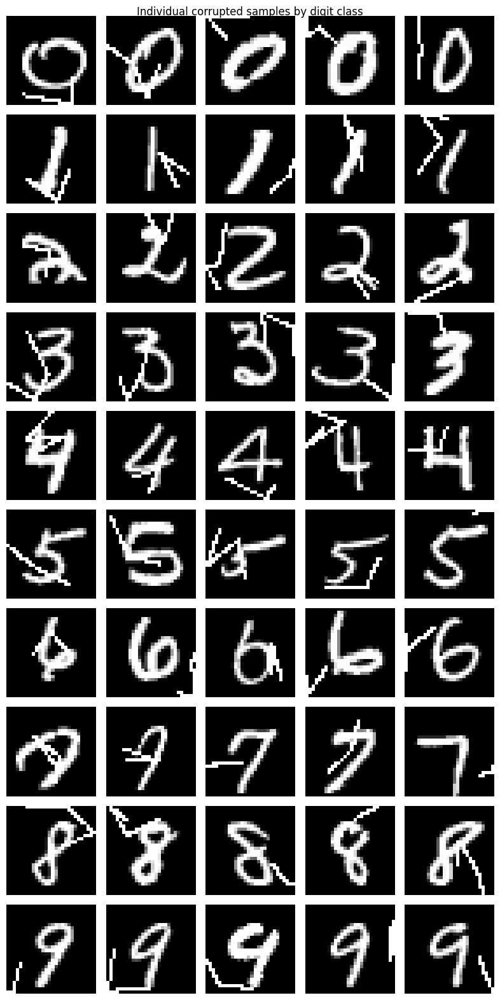
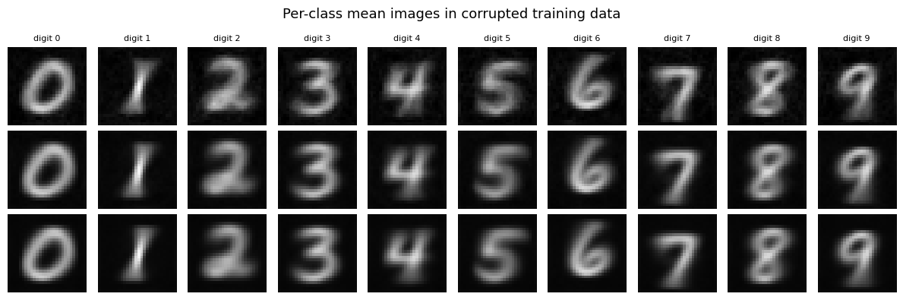
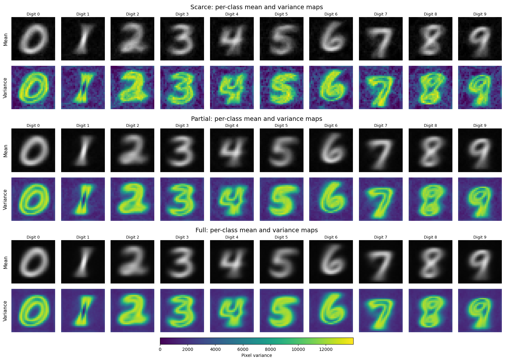
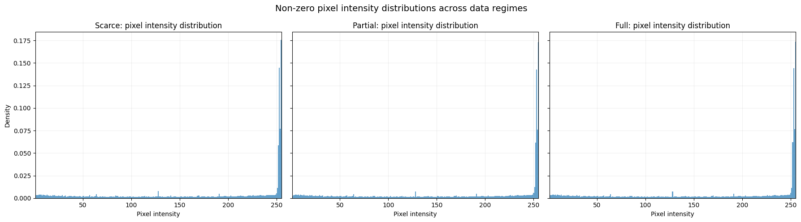
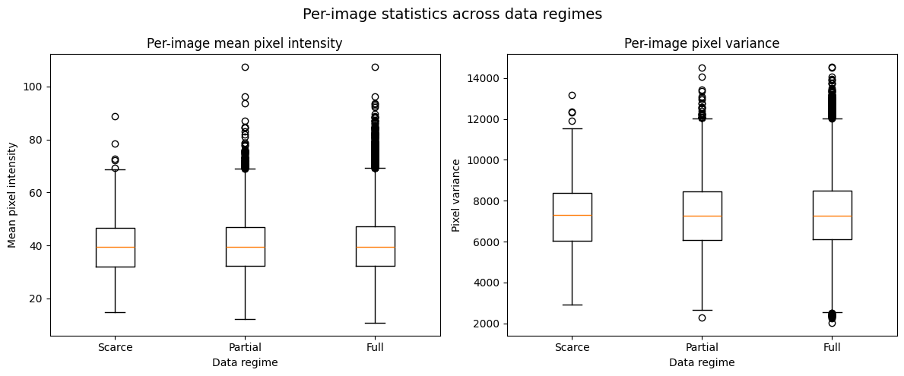
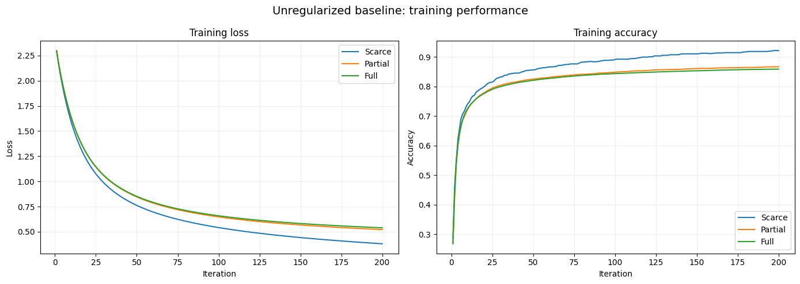
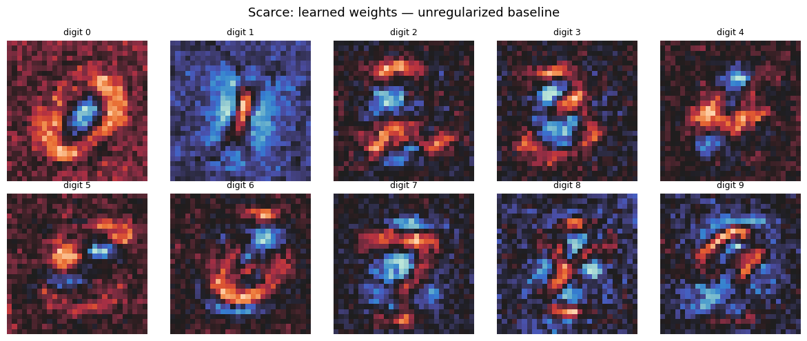
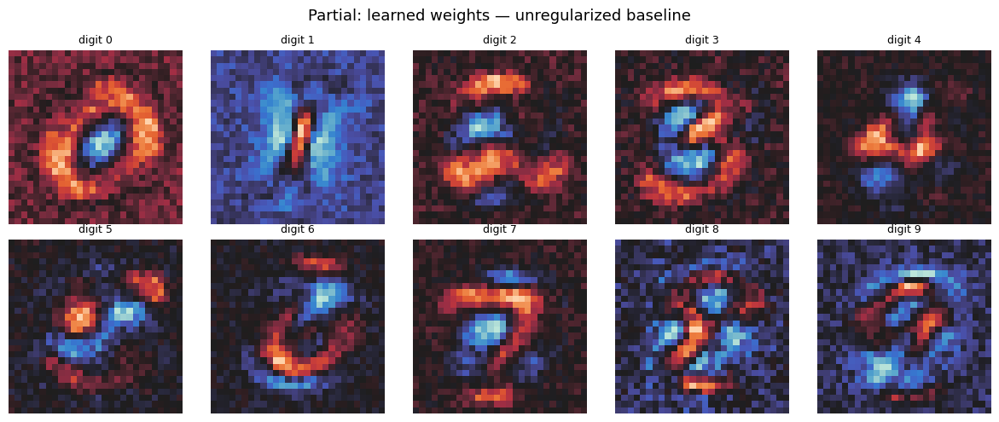
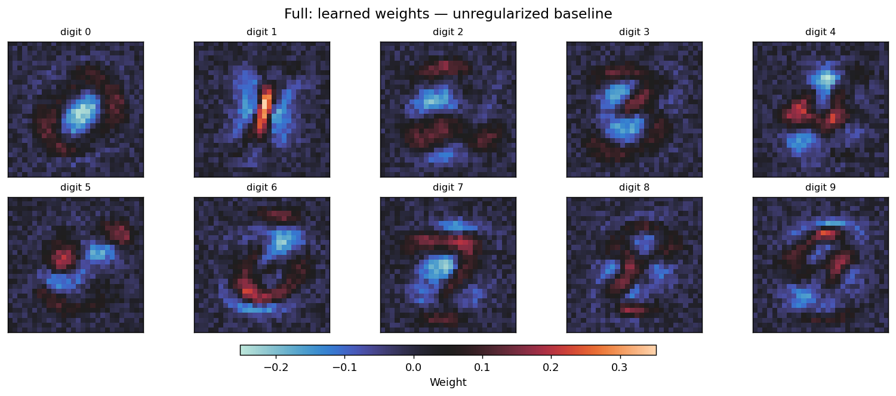
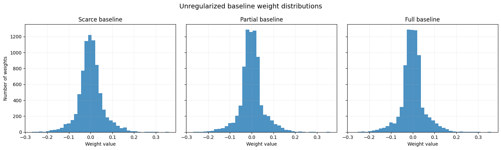

# Trabalho 2 — Perguntas e respostas

**MC886 — Introdução ao Aprendizado de Máquina**  
**Tema:** Seleção de modelos e regularização

Perguntas e respostas extraídas do [notebook traduzido](./mc886_2s2026_assignment_2_traduzido.ipynb). As respostas existentes foram mantidas; as questões ainda sem resposta estão indicadas como pendentes. As figuras são as saídas salvas da execução do notebook.

## 1. Análise e pré-processamento dos dados

### Questão 1.1 — Explorando a corrupção (1,0 ponto)

#### Item (a)

**Pergunta:** Descreva a corrupção. Ela é aleatória e específica de cada amostra ou é sistemática e compartilhada entre as imagens? Ela varia entre as classes de dígitos?

**Resposta:**

A corrupção parece ser aleatória no nível das amostras, mas estruturada dentro de cada amostra. Não se trata de ruído independente por pixel: os artefatos adicionados formam traços coerentes, semelhantes a linhas. Entretanto, suas posições e orientações variam entre as imagens. Como a corrupção não está espacialmente alinhada de uma amostra para outra, ela não produz um padrão fixo forte nas médias por classe.

Não há evidências fortes de que o mecanismo de corrupção em si dependa da classe. O mesmo tipo de traço adicionado pode ser observado em todas as classes de dígitos. Os mapas de média e variância por classe também são muito semelhantes nos três regimes de dados. As diferenças entre as classes se devem principalmente à geometria dos próprios dígitos, e não a um processo de corrupção claramente diferente.

A distribuição das intensidades dos pixels, as frações de pixels com valores extremos, as médias por imagem e as variâncias por imagem também são muito semelhantes entre os regimes de dados escassos, parciais e completos. Isso reforça a ideia de que os conjuntos de dados são amostrados essencialmente do mesmo processo de geração de dados corrompidos.

*Amostras corrompidas organizadas por classe de dígito.*

#### Item (b)

**Pergunta:** Por que a corrupção se transforma em um fundo tênue e quase uniforme nas imagens médias por classe? O que isso revela sobre o uso de imagens médias para diagnosticar uma corrupção?

**Resposta:**

A corrupção se transforma em um fundo tênue porque os traços adicionados variam em posição e orientação entre as amostras, de modo que são diluídos quando se calcula a média das imagens. Em contrapartida, a estrutura dos dígitos está alinhada de forma mais consistente e, por isso, permanece visível. Isso mostra que as imagens médias, por si só, podem ocultar uma corrupção estruturada e específica de cada amostra. Portanto, também são necessárias amostras individuais e estatísticas como a variância por pixel.

*Imagens médias por classe nos regimes de dados escassos, parciais e completos.*

*Mapas de média e variância por pixel e por classe nos três regimes de dados.*

#### Item (c)

**Pergunta:** A corrupção é composta por traços, e os dígitos também são compostos por traços. Quais dígitos você espera que sejam mais facilmente confundidos com a corrupção ou por causa dela?

**Resposta:**

Os dígitos mais vulneráveis devem ser aqueles cuja identidade depende fortemente de um pequeno número de traços locais, pois um traço artificial adicional pode criar ou suprimir uma característica importante para distingui-los de outra classe.

Em particular, dígitos como 1, 4, 7 e 9 podem ser mais vulneráveis porque sua identidade depende fortemente de poucos traços, tornando-os mais fáceis de confundir quando são adicionados artefatos semelhantes a traços. Entretanto, essa é apenas uma hipótese baseada na análise exploratória. Ela deve ser verificada posteriormente por meio das acurácias de classificação por classe.

#### Item (d)

**Pergunta:** Há regimes de dados nos quais a corrupção pode afetar o modelo mais do que em outros?
Formule hipóteses sobre como esses diferentes regimes afetarão um modelo treinado com eles.

**Resposta:**

A análise exploratória sugere que a distribuição da corrupção em si é muito semelhante entre os regimes de dados escassos, parciais e completos, pois os conjuntos menores são subamostras do conjunto completo. A principal diferença, portanto, é a quantidade de dados de treinamento disponíveis.

- *Regime de dados escassos*: deve ser o mais afetado. Com poucos exemplos de treinamento, o modelo tem menos oportunidades de observar que os traços da corrupção aparecem em posições inconsistentes e não têm relação com o rótulo da classe. Isso aumenta a probabilidade de sobreajuste devido a associações acidentais entre determinados padrões de corrupção e determinados dígitos.
- *Regime de dados parciais*: o efeito observado no regime de dados escassos provavelmente será reduzido, pois o modelo observa uma variedade maior de realizações da corrupção. É menos provável que padrões espúrios permaneçam consistentemente associados a uma classe, embora o sobreajuste ainda possa ocorrer em modelos suficientemente flexíveis.
- *Regime de dados completos*: deve ser o mais robusto. Com muitos exemplos, a corrupção específica de cada amostra deve se diluir estatisticamente, enquanto as características que identificam consistentemente cada dígito continuam sendo preditivas. Assim, o modelo dispõe de mais evidências para separar a estrutura estável dos dígitos da corrupção instável.

*Distribuições das intensidades dos pixels não nulos nos três regimes de dados.*

*Distribuições da média e da variância das intensidades por imagem em cada regime.*

### Questão 1.2 — Pré-processamento (1,0 ponto)

**Pergunta:** Descreva as escolhas de pré-processamento feitas acima. Qual estratégia você escolheu e por quê?

**Resposta:**

Convertemos as imagens para `float32`, reorganizamos cada imagem de $28 \times 28 $ pixels em um vetor de características e reescalamos as intensidades dos pixels de $[0, 255]$ para $[1, 0]$, dividindo por 255.

Essa estratégia é adequada à regressão logística multinomial porque melhora o comportamento numérico da otimização baseada em gradientes e mantém todas as características dos pixels em uma escala comum, o que é particularmente importante quando se aplica regularização aos coeficientes. A divisão pelo valor fixo 255 também preserva a estrutura relativa das imagens corrompidas, mantém o pré-processamento idêntico entre os regimes de dados e não exige estimar estatísticas a partir dos dados de validação ou de teste. Não foi aplicada remoção de ruído, pois o objetivo é avaliar como a regularização lida com a corrupção, em vez de removê-la previamente.

## 2. Regressão logística multinomial

### Implementação do modelo e da regularização (2,0 pontos)

Implemente o modelo de regressão logística multinomial utilizando `nn.Module` do PyTorch para o modelo linear (imagem como entrada e logits como saídas) e SGD com os métodos de regularização L1 e L2.

A implementação está no notebook.

### Questão 2.3 — Modelo de referência (2,0 pontos)

Treine um modelo sem regularização em cada conjunto de treinamento e observe a perda de treinamento por iteração de cada modelo durante o treinamento.

Para diagnosticar e compreender o que o modelo treinado aprendeu, visualizamos os pesos aprendidos como um mapa de calor.

**Pergunta:**

Examine as imagens dos pesos de cada modelo de referência. Como você explica os valores dos pesos no mapa de calor e quais padrões eles apresentam?

Compare os modelos: em que eles diferem?

**Resposta já escrita no notebook:**

**1. Acurácia e perda de treinamento ao longo das iterações**

- A otimização nos três regimes ocorre de forma suave: a perda diminui monotonicamente e a acurácia de treinamento aumenta ao longo das 200 iterações.
- O regime de dados escassos (Scarce) se distancia dos outros dois desde cedo e atinge o melhor ajuste aos dados de treinamento, com acurácia final de **0,9210** e perda final de **0,3801**.
- Os regimes de dados parciais (Partial) e completos (Full) permanecem muito próximos durante todo o treinamento, terminando com acurácia/perda de **0,8665** / **0,5210** e **0,8584** / **0,5388**, respectivamente.

*Perda e acurácia de treinamento dos modelos sem regularização ao longo das iterações.*

**Imagens dos pesos e distribuições produzidas no notebook:**

*Pesos aprendidos pelo modelo de referência no regime de dados escassos (Scarce).*

*Pesos aprendidos pelo modelo de referência no regime de dados parciais (Partial).*

*Pesos aprendidos pelo modelo de referência no regime de dados completos (Full).*

*Distribuições dos pesos dos modelos de referência nos três regimes de dados.*

*Pendente: completar a resposta sobre os padrões das imagens dos pesos e as diferenças entre os modelos.*

## Parte 3. Regularização

**(2,0 pontos)**

Agora introduzimos a regularização e exploramos uma grade de valores de $\lambda$ para as penalidades L1 e L2.

Seu **único critério de decisão** nesta parte é a acurácia de validação cruzada calculada sobre os dados de treinamento corrompidos, exatamente o que você teria em um cenário real sem acesso a um conjunto de teste sem corrupção ou com uma corrupção diferente.

Para cada configuração (regime de dados × tipo de regularização × $\lambda$), use validação cruzada com K partições (K-fold) para estimar a acurácia de validação (informe a média **e** o desvio padrão entre as partições).
Em seguida, para cada regularizador, **selecione o melhor $\lambda$** por validação cruzada (CV) e treine um modelo final com todo o conjunto de treinamento daquele regime.

Treine e armazene também um modelo para **cada** $\lambda$ da grade no regime de dados completos (Full-data): eles serão usados apenas nos gráficos de diagnóstico da Parte 4, e não na seleção.

> **Tarefa de decisão:** Informe, para cada regularizador e regime de dados, qual $\lambda$ você selecionou e por quê.
Examine as imagens dos pesos dos modelos escolhidos e descreva o que observa.

### Questão 3

The regimes differ in the number of training images: **Scarce** uses 1,000 images, **Partial** uses 10,000, and **Full** uses 60,000. All three contain the same type of corruption, consisting of artificial strokes; impulse noise (*salt-and-pepper*) belongs to a separate test distribution.

Each regime has its own baseline and its own L1 and L2 models selected through cross-validation. After selection, the final model is trained on all the data available in that regime. When the selected value is $\lambda=0$, the model is identical to that regime's baseline.

| Regime | Selected $\lambda$ — L1 | Selected $\lambda$ — L2 |
|--------|-------------------------|-------------------------|
| Scarce | $10^{-4}$ | $0$ |
| Partial | $0$ | $0$ |
| Full | $0$ | $0$ |

Selection uses the highest mean validation accuracy; exact ties are resolved by choosing the smallest $\lambda$.

#### Item (a)

**Pergunta:** À medida que $\lambda$ aumenta na regularização L2, como a acurácia de validação cruzada muda em cada regime de dados?
Há valores ótimos claros ou a acurácia atinge um patamar? A diferença entre o melhor $\lambda$ e seus vizinhos é maior que o desvio padrão entre as partições?

**Answer:**

Across all three regimes, L2 validation accuracy shows a plateau for small values of $\lambda$. The highest means occurred at $\lambda=0$: approximately **81.50% for Scarce**, **85.57% for Partial**, and **85.69% for Full**. The differences from neighboring candidates are smaller than the standard deviations across folds, approximately **1.23**, **0.80**, and **0.22 percentage points**, respectively. Therefore, no positive value of $\lambda$ is clearly superior. This comparison is descriptive and is not a statistical significance test.

With stronger regularization, performance decreases: at $\lambda=0.1$, accuracy is approximately **80.60%**, **82.67%**, and **82.75%**, respectively. L2 reduces coefficient magnitudes and, when excessive, can restrict learning and cause underfitting. This does not imply setting coefficients exactly to zero, nor does it require accuracy to decrease strictly monotonically with every increase in $\lambda$.

#### Item (b)

**Pergunta:** Compare as imagens dos pesos do modelo L2 selecionado por validação cruzada, do modelo L1 selecionado por validação cruzada e do modelo de referência sem regularização. Quais diferenças você observa em termos de estrutura e esparsidade?

**Answer:**

For Partial and Full, both L1 and L2 selected $\lambda=0$. Thus, the selected models are identical to the baseline and have the same weights and sparsity. For Scarce, L2 also selected $\lambda=0$, whereas L1 selected $\lambda=10^{-4}$. In the latter case, coefficient changes are small and preserve the overall structure of the weight maps, as also indicated by the points lying close to the diagonal in the paired-coefficient plot.

Across the grid, differences become more apparent among candidates with stronger regularization: L1 can concentrate more coefficients near zero, whereas L2 shrinks their magnitudes more broadly. However, these candidates were not selected by cross-validation. Furthermore, weights near zero are not equivalent to exact zeros; the training procedure uses subgradient SGD with a fixed learning rate for L1. Excessive regularization can weaken useful features and cause underfitting.

#### Item (c)

**Pergunta:** Relacione as imagens dos pesos à estrutura da corrupção identificada na Parte 1. O modelo selecionado por validação cruzada parece ter suprimido o padrão da corrupção, amplificado esse padrão ou isso é ambíguo quando se observam apenas os pesos?

**Answer:**

In Part 1, we observed that the corruption produces strokes whose positions and orientations vary across images. The weight maps show structures related to the digits, but both types of strokes can occupy similar regions. Therefore, we cannot reliably identify which coefficients respond to the corruption.

Since the selected models are identical or very close to the baseline, there is no clear visual evidence that they suppress or amplify the corruption. Even among candidates with strong regularization, shrinking coefficients can reduce both useful information and responses to noise. The conclusion remains ambiguous when examining weights alone. This does not mean that the corruption is irrelevant: cross-validation uses corrupted images for both training and validation and therefore does not isolate its impact relative to clean images.

#### Item (d)

**Pergunta:** **Preveja**, com base no que você observa nos pesos e nas curvas de validação cruzada, qual dos seus três modelos selecionados por validação cruzada (sem regularização / L2 / L1) você espera que tenha o melhor desempenho em imagens sem corrupção e qual terá o melhor desempenho em imagens com ruído impulsivo. Justifique sua previsão antes de ver qualquer resultado de teste.

**Answer:**

For Partial and Full, we predict the same performance for all three models on clean images and images with impulse noise, since the selected models are identical to the baseline and produce the same predictions. This equality holds within each regime; the Partial and Full models were trained on different datasets.

For Scarce, L2 is also identical to the baseline. L1 applies weak regularization and provides a small validation gain: approximately **81.70% versus 81.50%** for the baseline, a difference of **0.20 percentage points**, which is smaller than the standard deviation across folds of approximately **1.29 percentage points** for the selected L1 model. We therefore expect similar performance, with insufficient evidence to identify a clear winner on either test distribution. A small advantage on corrupted validation images does not guarantee an advantage on clean images or images with impulse noise. This prediction is made without using test results.

## Parte 4. Teste

**(2,0 pontos)**

Até agora, todas as decisões, a análise do tamanho do conjunto de dados e a seleção da regularização foram feitas utilizando apenas os dados de treinamento corrompidos e a validação cruzada.
**Agora usamos os conjuntos de teste** para avaliar os modelos que você selecionou.

1. Avalie todos os modelos escolhidos (modelo de referência, L2 e L1 selecionados por validação cruzada, para cada regime de dados) nas três versões do conjunto de teste.
2. Usando os modelos do regime de dados completos armazenados para cada $\lambda$, trace as **curvas de compromisso (trade-off)**: acurácia em `test_corrupted` versus acurácia em `test_clean` e versus acurácia em `test_impulse`, com uma curva por regularizador, destacando os modelos selecionados por validação cruzada.
3. Trace a **esparsidade** (fração de pesos com $|w| < 10^{-3}$) dos modelos L1 e L2 em função de $\lambda$.
4. Calcule a **acurácia por classe** em cada versão do conjunto de teste para os modelos selecionados por validação cruzada e identifique quais dígitos são mais prejudicados por cada corrupção.

### Questão 4

#### Item (a)

**Pergunta:** Descreva o formato da curva de compromisso (teste corrompido versus teste sem corrupção). Existe uma região na qual aumentar a regularização melhora simultaneamente ambas as acurácias? Existe uma região de compromisso efetivo entre elas?

*Resposta pendente.*

#### Item (b)

**Pergunta:** Os modelos selecionados por validação cruzada estão destacados no gráfico. Onde eles se situam em relação à fronteira de compromisso? O que isso revela sobre o uso da validação cruzada como critério de seleção de modelos quando as distribuições de treinamento e de uso em produção são diferentes?

*Resposta pendente.*

#### Item (c)

**Pergunta:** Retome sua previsão da Questão 3(d). Ela estava correta? Caso contrário, o que as imagens dos pesos não revelaram, mas os resultados de teste expuseram?

*Resposta pendente.*

#### Item (d)

**Pergunta:** Relacione o gráfico de esparsidade aos resultados fora da distribuição de treinamento. Por que a regularização L1 pode se comportar de forma diferente da L2 quando avaliada em imagens sem corrupção e em imagens com ruído impulsivo?

*Resposta pendente.*

#### Item (e)

**Pergunta:** Compare `test_clean` e `test_impulse`. O treinamento com uma corrupção tornou o modelo robusto a outra? Qual regime de dados e qual regularizador apresentaram a melhor transferência, e por quê?

*Resposta pendente.*

#### Item (f)

**Pergunta:** Use as acurácias por classe para verificar sua resposta à Questão 1.1(c). Quais dígitos são mais prejudicados por cada corrupção?

*Resposta pendente.*

#### Item (g)

**Pergunta:** Em um cenário real de uso em produção, nem o conjunto de teste sem corrupção nem o conjunto com ruído impulsivo estariam disponíveis durante a seleção do modelo. Dispondo apenas de dados de validação corrompidos, quais estratégias práticas um profissional poderia usar para tomar uma decisão de seleção de modelo melhor do que simplesmente maximizar a acurácia de validação cruzada?

*Resposta pendente.*

## Resumo

Complete a tabela abaixo com os resultados de seus experimentos (regime de dados completos, Full-data). Use o melhor modelo de acordo com cada critério.

| Modelo | $\lambda$ | Acurácia de CV (média ± desvio padrão) | Acurácia de teste (corrompido) | Acurácia de teste (sem corrupção) | Acurácia de teste (impulsivo) | Diferença sem corrupção | Diferença impulsivo |
|--------|-----------|--------------------------------------|-------------------------------|-----------------------------------|------------------------------|-------------------------|---------------------|
| Sem regularização (referência) | 0 | | | | | | |
| Melhor CV, L2 | | | | | | | |
| Melhor CV, L1 | | | | | | | |
| Menor diferença sem corrupção, L2 | | | | | | | |
| Menor diferença sem corrupção, L1 | | | | | | | |
| Menor diferença impulsivo, L2 | | | | | | | |
| Menor diferença impulsivo, L1 | | | | | | | |

*Diferença sem corrupção = acurácia de teste (corrompido) - acurácia de teste (sem corrupção); diferença impulsivo = acurácia de teste (corrompido) - acurácia de teste (impulsivo).*

*Tabela ainda não preenchida no notebook.*
